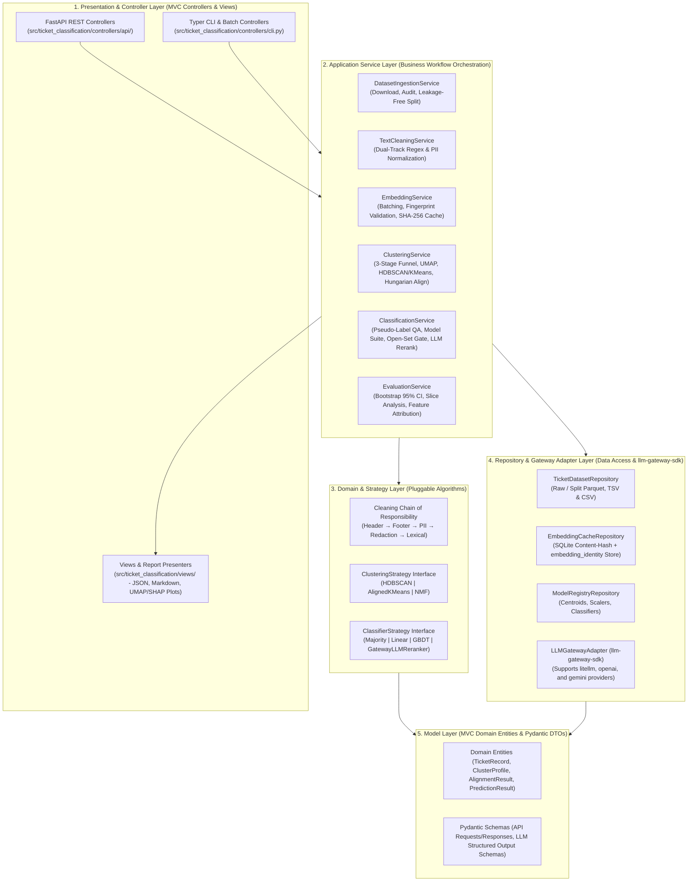

# Architecture & Implementation Plan: Cloud-Native Ticket & Claim Clustering and Classification System

This document synthesizes architectural analyses and battle-tested best practices from five leading open-source GitHub repositories (**100+ to 8,500+ stars**), live benchmark datasets extracted directly from those repositories, a **Provider-Swappable Cloud Model Strategy** powered by [`eslam-aboutaleb/llm-gateway-sdk`](https://github.com/eslam-aboutaleb/llm-gateway-sdk) and [`eslam-aboutaleb/llm-gateway`](https://github.com/eslam-aboutaleb/llm-gateway) (supporting seamless switching between **Gemini** and **OpenAI**), and a **Service-Oriented MVC / Clean Architecture** with explicit design patterns.

---

## Part 1: Repository Analysis & Extracted Best Practices

### 1. [MaartenGr/BERTopic](https://github.com/MaartenGr/BERTopic) (⭐ 8,500+)
**Core Focus:** Modular topic modeling, semantic clustering, and inductive cluster inference.

* **Best Practices Adopted:**
  1. **Dual-Track Text Processing:** Never over-clean text before calling Cloud Embedding APIs. Feed *contextually intact* text (headers/footers stripped, typed PII placeholders preserved) into the **LLM Gateway Embedding API** (`rag-embedding` / `text-embedding-3-small` / `gemini-embedding-001`), while feeding *lexically normalized* text (lowercased, stop-words removed, lemmatized, POS noun-filtered) into the **c-TF-IDF / Cluster Keyword Extractor** post-clustering.
  2. **UMAP Dimensionality Reduction Before Density Clustering:** Project high-dimensional cloud embeddings (768–1536 dims) to 5–15 dimensions via UMAP (`metric='cosine'`) prior to clustering, and separately to 2D for visual scatterplots.
  3. **Systematic Outlier Recovery (`-1` Cluster):** Reassign HDBSCAN noise points (`-1`) to their nearest cluster centroid when cosine similarity or c-TF-IDF probability exceeds a configurable confidence threshold $\tau_{\text{recover}}$.

---

### 2. [thuiar/TEXTOIR](https://github.com/thuiar/TEXTOIR) (⭐ 250+) & [thuiar/DeepAligned-Clustering](https://github.com/thuiar/DeepAligned-Clustering) (⭐ 130+)
**Core Focus:** Open-intent discovery, automatic cluster count estimation, iterative pseudo-labeling, and open-set classification on banking and support datasets (`Banking77`, `CLINC150`, `StackOverflow`).

* **Best Practices Adopted:**
  1. **Automated $K$-Estimation (`predict_k` with Dropout Filtering):** Initialize K-Means with an upper-bound $K_{\max}$ and filter out micro-clusters whose cardinality falls below the uniform expected density threshold $\tau = \frac{N}{K_{\max}}$, combined with sweeping **Silhouette Score** across candidate $K$ values.
  2. **Hungarian Algorithm Centroid Alignment (`linear_sum_assignment`):** Whenever clusters are recomputed across runs or periodic re-clustering batches, compute the Euclidean/Cosine distance matrix between previous and new centroids and apply `scipy.optimize.linear_sum_assignment` so cluster IDs remain deterministic and never permute.
  3. **Open-Set Novelty Gate:** Do not force every incoming ticket into an existing cluster if its distance to all cluster centroids exceeds a calibrated decision boundary; route out-of-distribution tickets to an `EMERGING_UNSEEN_INTENT` queue for periodic re-clustering.

---

### 3. [karolzak/support-tickets-classification](https://github.com/karolzak/support-tickets-classification) (⭐ 165+)
**Core Focus:** Enterprise helpdesk data hygiene, PII anonymization, multi-target classification (`ticket_type`, `category`, `impact`, `urgency`), and handling severe class imbalance.

* **Best Practices Adopted:**
  1. **Ordered Email & Ticket Boilerplate Stripping (`0_preprocess_data.py`):** Strip email forwarding headers (`From:`, `Sent:`, `Received:`, `To:`, `CC:`, `Subject:`), legal confidentiality footers, inline CID image artifacts (`[cid:...]`), URLs, and internal ticket IDs (`INC...`, `RITM...`, `TKT...`).
  2. **Typed PII Placeholders & Categorical Encryption:** Replace emails, phone numbers, dollar amounts, and account IDs with typed semantic tokens (`<EMAIL>`, `<PHONE>`, `<AMOUNT>`, `<ACCOUNT_ID>`) rather than deleting them blindly.
  3. **Minimum Class Cardinality Gating (`min_data_per_class`):** Enforce a minimum support threshold per discovered cluster before training supervised classifiers, merging ultra-rare micro-clusters into an `OTHER_RARE` bucket.

---

### 4. [airweave-ai/error-monitoring-agent](https://github.com/airweave-ai/error-monitoring-agent) (⭐ 380+)
**Core Focus:** Cost-efficient multi-stage clustering funnel, Cloud LLM structured outputs, and stateful deduplication.

* **Best Practices Adopted:**
  1. **Three-Stage Cost-Saving Clustering Funnel (`backend/pipeline/clustering.py`):**
     * **Stage 1 (Strict Match):** Collapse identical tickets/alerts by normalized hash or exact metadata signature.
     * **Stage 2 (Regex / Pattern Match):** Group tickets sharing normalized templates (after masking variable IDs, timestamps, and numbers).
     * **Stage 3 (Cloud Embedding + Cloud LLM Semantic Grouping):** Call Cloud Embedding and Cloud LLM APIs *only* on deduplicated representative tickets, cutting cloud API token spend by 60–90%.
  2. **Structured Pydantic LLM Cluster Naming:** Use Cloud LLM structured JSON outputs (`ClusterGroupSchema`, `ClusterSummarySchema`) to generate concise, human-readable cluster titles (50–150 chars) and descriptions from cluster medoids and top c-TF-IDF terms.

---

### 5. Financial Claims & CFPB Ticket Classification Blueprints ([sukhijapiyush](https://github.com/sukhijapiyush/NLP-Case-Study---Automatic-Ticket-Classification), [RakshithaBS](https://github.com/RakshithaBS/Automatic-Ticket-Classification))
**Core Focus:** Unsupervised topic discovery $\rightarrow$ pseudo-label taxonomy mapping $\rightarrow$ supervised multi-class classification on 78,000+ consumer financial claims.

* **Best Practices Adopted:**
  1. **Redaction Mask Normalization:** Normalize upstream redaction masks (`XXXX`, `XX/XX/XXXX`, `[REDACTED]`) into a single `<REDACTED>` token so masks do not pollute TF-IDF vocabularies or embeddings.
  2. **POS Noun Filtering for Topic Keywords:** Filter lexical tokens for nouns/noun phrases when computing c-TF-IDF / NMF topic terms so discovered clusters reflect concrete products and claim types (*Credit Card*, *Mortgage*, *Unauthorized Wire*) rather than conversational verbs.
  3. **Fast Linear Classifiers on Cloud Embeddings:** Pair cloud embeddings + TF-IDF with regularized linear classifiers (`LogisticRegression`, `CalibratedClassifierCV(LinearSVC)`) and `LightGBM`, which achieve ~0.91+ F1 and sub-millisecond classification latency once embeddings are fetched.

---

## Part 2: Verified Benchmark Datasets from These Repositories (For Testing)

We inspected the repositories and verified **live, directly downloadable datasets** spanning financial claims, banking queries, IT service desk tickets, and production error incidents:

| Dataset ID | Source Repository / Mirror | Domain & Task | Size & Classes | Direct Download URL / Identifier (Verified HTTP 200) |
| :--- | :--- | :--- | :--- | :--- |
| **`textoir_banking77`** | `thuiar/TEXTOIR` & `thuiar/DeepAligned-Clustering` | Fine-grained customer banking support queries (`text`, `label`) for open-intent clustering & classification | **13,083 rows** (`train.tsv`, `dev.tsv`, `test.tsv`), 77 intents | `https://raw.githubusercontent.com/thuiar/TEXTOIR/main/data/banking/train.tsv` *(+ `dev.tsv`, `test.tsv`)* |
| **`airweave_incidents`** | `airweave-ai/error-monitoring-agent` | Production error & incident tickets with stack traces, HTTP codes, and timestamps | **20+ curated multi-stage incident samples** | `https://raw.githubusercontent.com/airweave-ai/error-monitoring-agent/main/backend/samples/errors.py` |
| **`it_service_tickets`** | `cibhibaskar/IT-service-ticket-classification` & `karolzak` | Enterprise IT helpdesk support tickets (`Document`, `Topic_group`) | **47,837 rows** (~14.5 MB CSV), 8 IT queues (*Hardware, Access, HR, Storage, etc.*) | `https://raw.githubusercontent.com/cibhibaskar/IT-service-ticket-classification/main/all_tickets_processed_improved_v3.csv` |
| **`cfpb_claims`** | `RitikKumar3` / `sukhijapiyush` / `RakshithaBS` (CFPB Financial Claims) | Unlabeled & labeled consumer financial claims (`complaint_what_happened`, `product`, `sub_product`, `issue`) with `XXXX` PII masks | **78,313 rows** (~83 MB JSON) $\rightarrow$ 5 to 18 claim clusters | `https://raw.githubusercontent.com/RitikKumar3/Automatic-Ticket-Classification/main/complaints-2021-05-14_08_16.json` |
| **`textoir_clinc_oos`** | `thuiar/TEXTOIR` & `thuiar/DeepAligned-Clustering` | Multi-domain support & insurance/banking claims (`insurance_change`, `rollover_401k`, `replacement_card_duration`) + Out-of-Scope (`oos`) anomalies | **23,700 rows** (`train.tsv`, `dev.tsv`, `test.tsv`), 150 intents + open-set `oos` | `https://raw.githubusercontent.com/thuiar/TEXTOIR/main/data/clinc/train.tsv` |
| **`textoir_stackoverflow`** | `thuiar/TEXTOIR` | Technical issue tickets (`text`, `label`) | **20,000 rows** (`train.tsv`, `dev.tsv`, `test.tsv`), 20 categories | `https://raw.githubusercontent.com/thuiar/TEXTOIR/main/data/stackoverflow/train.tsv` |

---

## Part 3: Cloud Provider & Self-Hosted LLM Gateway Strategy (`llm-gateway-sdk` + `llm-gateway`)

### 1. Provisioned Gateway Key & Model Aliases
A dedicated virtual key has been issued on [`eslam-aboutaleb/llm-gateway`](https://github.com/eslam-aboutaleb/llm-gateway) (`https://82.70.210.36.sslip.io/v1`) for this project and stored in `.env` (git-ignored):
* **Key Alias:** `ticket-classification-key`
* **User ID:** `TICKET_CLASSIFICATION`
* **Allowed Gateway Deployments:** `general-fast`, `general-reasoning`, `structured-output`, `agent-tools`, `rag-embedding`
* **Registered Per-Key Provider Aliases (`set-model-alias`):**
  * **OpenAI Models:** `gpt-4o-mini` $\rightarrow$ `general-fast`, `gpt-4o` $\rightarrow$ `general-reasoning`, `text-embedding-3-small` $\rightarrow$ `rag-embedding`
  * **Gemini Models:** `gemini-3.8-flash` $\rightarrow$ `general-fast`, `gemini-4-argon` $\rightarrow$ `general-reasoning`, `gemini-embedding-001` $\rightarrow$ `rag-embedding`

### 2. Provider-Agnostic Client via `llm-gateway-sdk`
All chat completions, structured JSON extractions, and vector embeddings use [`eslam-aboutaleb/llm-gateway-sdk`](https://github.com/eslam-aboutaleb/llm-gateway-sdk) (`GatewayBaseSettings`, `GatewayClient`, `AsyncGatewayClient`):
* **Switchable Provider Catalog (`LLMProvider`):**
  * `LLM_PROVIDER=litellm` $\rightarrow$ Uses gateway capability aliases (`general-fast`, `general-reasoning`, `structured-output`, `rag-embedding`).
  * `LLM_PROVIDER=openai` $\rightarrow$ Uses OpenAI models (`gpt-4o-mini`, `gpt-4o`, `text-embedding-3-small`) routed through `llm-gateway-sdk`.
  * `LLM_PROVIDER=gemini` $\rightarrow$ Uses Gemini models (`gemini-3.8-flash`, `gemini-4-argon`, `gemini-embedding-001`) routed through `llm-gateway-sdk` (or optional direct `google-genai` adapter if configured).
* **Vector Fingerprint & SHA-256 Cache (`embedding_identity`):**
  * Mirrors the battle-tested `polymarket_settings` pattern: every cached embedding batch records `sha256(json.dumps([model, api_base, dimensions]))` so switching models or dimensions automatically namespaces the SQLite/Parquet embedding cache without collisions or duplicate token spend.

---

## Part 4: Code Architecture, MVC + Service Layer & Design Patterns

### 1. Architectural Pattern: Layered MVC + Service-Oriented Clean Architecture

We separate concerns into five strict layers with unidirectional dependency flow (`Controllers / Views` $\rightarrow$ `Services` $\rightarrow$ `Domain Pipeline & Strategies` $\rightarrow$ `Repositories & Gateway Adapters` $\rightarrow$ `Models / Schemas`):



---

### 2. Core Design Patterns Used

| Design Pattern | Where It Is Used | Why It Is Needed in This Project |
| :--- | :--- | :--- |
| **1. Strategy Pattern** | `LLMProvider` (`litellm`, `openai`, `gemini`), `ClusteringStrategy` (`HDBSCAN`, `AlignedKMeans`, `NMF`), `ClassifierStrategy` (`MajorityBaseline`, `LogisticRegression`, `LinearSVC`, `LightGBM`, `GatewayLLMReranker`) | Allows switching between Gemini and OpenAI, clustering algorithms, or supervised classifiers via `.env` / config or API parameters without changing service logic. |
| **2. Chain of Responsibility** | `src/ticket_classification/domain/cleaning/handlers.py` (`EmailHeaderStripper` $\rightarrow$ `DisclaimerStripper` $\rightarrow$ `TypedPIIMasker` $\rightarrow$ `RedactionNormalizer` $\rightarrow$ `DualTrackBuilder`) | Each cleaning rule is an isolated, unit-testable handler. Datasets like `it_service_tickets` enable email header rules, while `cfpb_claims` enables `XXXX` redaction mask rules. |
| **3. Adapter / Gateway Pattern** | `src/ticket_classification/gateways/llm_gateway_adapter.py` | Wraps `llm-gateway-sdk` (`GatewayClient`, `AsyncGatewayClient`, `GatewayBaseSettings`) and provider model resolution (`litellm` / `openai` / `gemini`) behind a clean `CloudAIGateway` interface. |
| **4. Repository & Proxy-Cache Pattern** | `src/ticket_classification/repositories/embedding_cache_repo.py`, `dataset_repo.py`, `model_registry_repo.py` | Decouples business logic from storage. `EmbeddingCacheRepository` acts as a SQLite caching proxy keyed by `embedding_identity` + `SHA256(text)`. |
| **5. Template Method Pattern** | `src/ticket_classification/domain/base_stage.py` (`LeakageSafePipelineStage`) | Enforces the **Mandatory ML Split Rule**: `fit_transform(train_df)` fits state strictly on `train`, while `transform(val_df)` and `transform(test_df)` forbid refitting, making train-test leakage impossible. |
| **6. Factory & Dependency Injection (DI)** | `src/ticket_classification/core/container.py` (`ServiceContainer`) | Instantiates and injects repositories, `llm-gateway-sdk` clients, and strategies into services and FastAPI controllers (`Depends`), enabling 100% offline unit tests using `httpx.MockTransport` or `MockCloudGateway`. |

---

### 3. Complete Project Folder Structure

```text
ticket-classification/
├── .env                                   # Provisioned ticket-classification-key (git-ignored)
├── .env.example                           # Template environment configuration
├── .gitignore                             # Protects .env, data/, and caches
├── configs/
│   └── pipeline_config.yaml               # Dataset URLs, regex toggles, clustering/classifier params
├── data/
│   ├── raw/                               # Downloaded benchmark datasets (banking77, airweave, it_tickets, cfpb)
│   ├── interim/                           # Leakage-free split datasets (train, val, test)
│   ├── cache/                             # SQLite SHA-256 Cloud Embedding cache with embedding_identity
│   └── artifacts/                         # Saved centroids, model_registry.joblib, plots, reports
├── src/
│   └── ticket_classification/
│       ├── __init__.py
│       ├── config/
│       │   └── settings.py                # AppSettings(GatewayBaseSettings) + LLMProvider + ModelTier
│       ├── models/                        # [M in MVC] Domain Entities & Data Transfer Objects (DTOs)
│       │   ├── entities.py                # TicketRecord, ClusterProfile, AlignmentResult, PredictionResult
│       │   └── schemas.py                 # FastAPI Request/Response models & LLM Structured Output Schemas
│       ├── views/                         # [V in MVC] Presenters, Visualizers & Report Builders
│       │   └── report_view.py             # ReportAndPlotView: 2D scatterplots, confusion matrix, Markdown report
│       ├── controllers/                   # [C in MVC] HTTP API Routers & CLI Entrypoints
│       │   ├── api.py                     # ServiceContainer (DI), FastAPI Routers (/provider, /clusters, /classify)
│       │   └── cli.py                     # CLI entrypoint (ticket-clf runner)
│       ├── services/                      # Application Business Logic Layer
│       │   └── pipeline_service.py        # TicketPipelineService: end-to-end 7-phase orchestration & persistence
│       ├── domain/                        # Core Algorithms & Strategy Implementations
│       │   ├── base_stage.py              # Template Method enforcing Fit-on-Train-Only (zero leakage)
│       │   ├── cleaning/
│       │   │   └── handlers.py            # TextCleaningHandler Chain of Responsibility (Email, PII, XXXX, Stem)
│       │   ├── features/
│       │   │   └── metadata_encoder.py    # MetadataFeaturePipeline (leakage-safe tabular feature transform)
│       │   ├── clustering/
│       │   │   └── engine.py              # ClusteringEngine (DeepAligned predict_k, Hungarian alignment, c-TF-IDF)
│       │   └── classification/
│       │       └── engine.py              # ClassifierSuite (LogisticRegression, CalibratedLinearSVC, GBDT, Open-Set)
│       ├── repositories/                  # Data Persistence & Cache Layer
│       │   ├── dataset_repo.py            # TicketDatasetRepository (downloads & reads benchmark datasets)
│       │   ├── embedding_cache_repo.py    # EmbeddingCacheRepository (SQLite content-hash store)
│       │   └── model_registry_repo.py     # ModelRegistryRepository (joblib bundle save/load)
│       └── gateways/                      # External Cloud & Gateway SDK Adapters
│           └── llm_gateway_adapter.py     # BaseCloudGateway & LLMGatewaySDKAdapter (litellm, openai, gemini)
├── tests/
│   └── test_pipeline_and_mvc.py           # Comprehensive unit & integration test suite (offline mock + E2E)
├── .github/
│   ├── ci.json                            # Central CI discovery configuration (Python 3.11/3.12, 85% coverage)
│   ├── CODEOWNERS                         # Code ownership for workflows, Makefile, and configs
│   ├── pull_request_template.md           # Six-section PR description contract template
│   └── workflows/
│       ├── ci.yml                         # Calls eslam-aboutaleb/ci-workflows/.github/workflows/ci.yml
│       ├── pr-description.yml             # Calls eslam-aboutaleb/ci-workflows/.github/workflows/pr-description.yml
│       └── ml-benchmark.yml               # Calls eslam-aboutaleb/ci-workflows/.github/workflows/ml-benchmark.yml
├── Makefile                               # Standard ci-install, ci-quality, ci-docs, ci-eval, and ci-benchmark targets
├── pyproject.toml                         # Dependencies (llm-gateway-sdk, scikit-learn, fastapi, etc.)
└── PLAN.md                                # This architectural & implementation plan
```

---

## Part 5: Centralized CI/CD Pipeline (`eslam-aboutaleb/ci-workflows`)

The repository uses [`eslam-aboutaleb/ci-workflows`](https://github.com/eslam-aboutaleb/ci-workflows) (`@225793bab5a8d87363ffefda5e224b553c714bec`) for all continuous integration, security analysis, commit/PR governance, and ML benchmark evaluation:

1. **Aggregate Quality Gate (`.github/workflows/ci.yml` $\rightarrow$ `ci-workflows/.github/workflows/ci.yml`):**
   * **Semantic Commit Policy (`commit-messages.yml`):** Enforces `<type>(<scope>): <subject>` across all PR commits and default-branch pushes.
   * **Python Matrix (`python.yml`):** Runs Ruff lint (`ruff check .`), Ruff formatting (`ruff format --check .`), and `pytest` across Python `3.11` and `3.12` on `ubuntu-latest` with an enforced **85% minimum coverage gate** on `src/ticket_classification`.
   * **Makefile Project Contracts (`project-check.yml`):** Automatically discovers and runs `ci-quality` and `ci-docs` from `Makefile`.
   * **Trusted Default-Branch AI Evaluations (`ai-eval.yml`):** Automatically discovers `ci-eval` in `Makefile` and executes it on `main` pushes and `workflow_dispatch`.
   * **Security & Workflow Validation (`security.yml` & `workflow-lint.yml`):** Runs CodeQL (`python`, `actions`), Dependency Review, Gitleaks secret scanning (`secret-scanning.yml`), and `actionlint`.
2. **Pull Request Description Contract (`.github/workflows/pr-description.yml` $\rightarrow$ `ci-workflows/.github/workflows/pr-description.yml`):**
   * Validates the six-section PR description schema (`Description`, `Type of Change`, `Behavior and Compatibility`, `Verification Evidence`, `Independent Review`, `Checklist`).
3. **Reusable ML & LLM-Gateway Benchmark Workflow (`.github/workflows/ml-benchmark.yml` $\rightarrow$ `ci-workflows/.github/workflows/ml-benchmark.yml`):**
   * Added to [`eslam-aboutaleb/ci-workflows`](https://github.com/eslam-aboutaleb/ci-workflows/pull/17) to support parameterized `provider` (`litellm`, `openai`, `gemini`) and `dataset` benchmark runs (`ci-benchmark`), publishing `BENCHMARK_REPORT.md` to `$GITHUB_STEP_SUMMARY` and uploading `data/artifacts/*.png` with 7-day retention.

