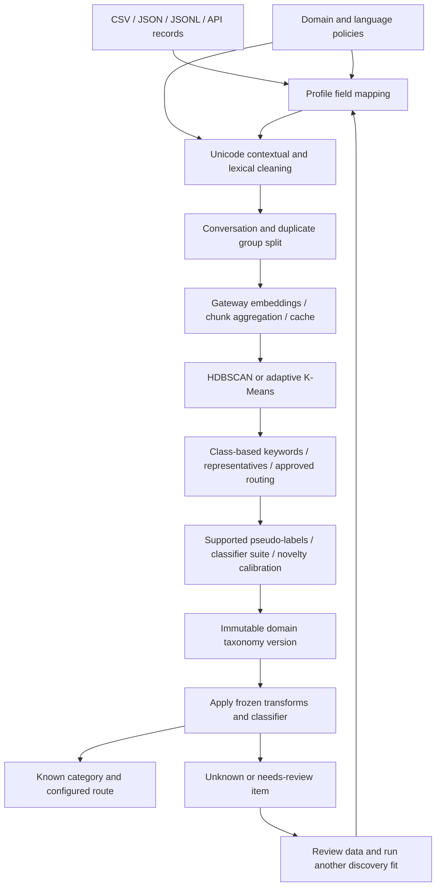

# Architecture and implementation: multilingual ticket and claim discovery

The shared pipeline handles customer-service inquiries, technical incidents and customer claims through configurable domain profiles and language policies. It embeds contextual text through `llm-gateway-sdk`, discovers semantic categories, trains classifiers against accepted discovery assignments, and rejects unsupported or novel items for review.

The [README](README.md) documents setup and API/CLI usage. The [repository comparison](REPOSITORY_COMPARISON.md) records the original source review, verified public repositories and design rationale. Its implementation findings refer to the revision reviewed before these changes.

## Implemented architecture

### Configuration and ingestion

`config/pipeline.py` validates domain, language, cleaning, embedding, discovery, metadata and classification policies. Unsupported options fail explicitly. Built-in domain IDs are `generic`, `customer_service`, `technical_incident` and `customer_claim`; configuration can define additional IDs without changing pipeline code.

`TicketDatasetRepository.adapt_frame` maps arbitrary source text/ID/label/language columns and flattens nested metadata. Labels are optional. The benchmark catalog remains a separate loader, with its URLs/columns supplied through configuration.

`TicketPipelineService.fit_dataframe` fits user data. `run_benchmark_pipeline` loads a benchmark and delegates to it. The CLI accepts local files and the API exposes fitting. Explicit strategy/K options override YAML; other runtime policy comes from the validated configuration. A loaded artifact restores its own fitted policies; subsequent refitting reloads current configuration.

### Multilingual processing

Language detection, tokenization and lexical processing have registration points. Unicode normalization defaults to NFC. The default detector is seeded for reproducibility and reports uncertainty; short input can be undetermined. Language hints remain separate source metadata.

Arabic/English mixed-script text is detected by script segments. Other configured languages use the detector and Unicode tokenizer, with character tokenization as the documented CJK fallback. Arabic character/diacritic normalization, language stopwords and technical-token preservation are configurable. English suffix heuristics and ASCII-only lexical filtering have been removed.

All supported languages use one declared aligned multilingual embedding deployment and a shared taxonomy. Domain profiles contain supported language lists; a configured list alone does not validate the deployment's quality. Translation is not required. Optional translation strategies and language-specific taxonomies remain future extensions; separate domain profiles can serve independent language-specific deployments today.

Contextual text retains meaning for embeddings. Lexical text supports keywords and classifier features. PII rules, boilerplate stripping and redaction normalization compose through the cleaning chain. HTML cleanup preserves unrecognized angle-bracket technical tokens. Masking covers the configured patterns, not every possible sensitive entity.

### Discovery and dynamic K

The default strategy uses scikit-learn HDBSCAN. It compares density/support candidates using original embedding-space separation, accepted coverage and resampling stability. One coherent group and all-noise outcomes are permitted. No forced K-Means fallback is used.

The alternative is **DeepAligned-inspired adaptive K-Means**, not the full DeepAligned neural algorithm. It derives feasible K bounds from sample count, unique vectors and minimum support, searches coarse-to-fine candidates, and uses separation, support and seed stability. Operators can supply bounds. Candidate budget, boundaries and coverage are recorded; a capped search is not presented as proof of a globally optimal taxonomy.

PCA, optional UMAP and no reduction are supported. Reducers are fitted once on training data. Discovery returns the actual fitted labels and strengths, preserving noise. Frozen prototype prediction is a separate inductive baseline; this sklearn HDBSCAN implementation does not expose external `hdbscan.approximate_predict` semantics. Accumulated unknown items require an explicit later fit to discover categories.

BERTopic supplies the modular architecture reference. The implemented class-based TF-IDF uses normalized aggregate class term counts and class-based IDF. The backward-compatible `medoid_texts` field holds centroid-nearest representatives; it does not claim pairwise-distance medoids.

### Classification, calibration and routing

The suite trains majority, logistic-regression, calibrated linear SVM and gradient-boosting models, plus a direct prototype comparison. Pseudo-label confidence and class-support filters are enforced. Supported single-class data uses a constant classifier; insufficient/no supported classes return review status rather than forcing a classifier.

Held-out supported validation examples calibrate the novelty gate in original embedding space. If unavailable, the report identifies the training-distance fallback. Evaluation and serving use the same gate. Model selection uses validation cluster agreement; that is distinct from business taxonomy correctness. Ground-truth mapping, when available, uses training labels only.

Unknown intent returns cluster `-1`, no stable category ID, and the review queue. Empty text, unavailable models and unsupported languages have a separate `needs_review` response. Low-confidence language or class assignments can require review. An LLM reranker cannot override geometric novelty. LLM naming/routing is restricted to configured approved routes.

Cluster IDs are independent of label language. Naming output can provide localized labels, and keywords are stored by language. Requested labels fall back to the primary name when a localization is unavailable.

### Persistence and concurrency

Each domain has an independent active model bundle and immutable taxonomy snapshots. Generic artifacts retain the previous default location; other domains have separate directories. Snapshots include preprocessing policy, vector width, representation identity, features, reducer, discovery state, classifiers, novelty threshold, taxonomy, stable IDs and lineage.

Representation identity includes provider model, gateway base, requested dimensions, declared revision/task and profile fingerprint. A changed identity fails inference until refitting. An alias can change behind an unchanged name; deployers must pin the revision and update it when the alias is repointed. The artifact manifest exposes whether a revision was declared.

Successful fits atomically publish an active bundle. Failed fits restore the preceding in-memory model. Per-service locks serialize fitting and inference; domain lookup has a separate lock. Stable category IDs use similarity matching across compatible representations and record births, retirements, splits and merges. This is heuristic lineage, not guaranteed semantic identity.

Rejected items are persisted as masked contextual text, language metadata and rejection reason in a domain-scoped review queue. Stale active taxonomy versions are rejected explicitly. Legacy pre-review bundles lack the complete contract and require a new fit.

### Evaluation and checks

Duplicate text and explicit conversation groups are connected before splitting. Explicit splits are validated for overlap. Temporal splitting validates timestamp availability and chronology. Learned lexical, metadata and reduction stages fit on training rows; the fit-before-transform base class is an API guard, not proof that an arbitrary caller supplied only training data.

Reports separate cluster agreement, train-mapped ground-truth performance, external cluster validity, per-language coverage and novelty flags. Domain-appropriate supplied OOS probes additionally report recall and known/unknown discrimination. Uniform-length and tiny datasets avoid undefined slice scores. Classifier-only timing is not end-to-end latency or API cost. Template counts are diagnostics; exact text/chunk caching is the implemented embedding cost optimization.

Run `make ci-quality` and `make ci-docs`. Tests cover the review regressions and the multilingual/domain lifecycle with offline gateways. Real-world accuracy, dialect coverage, business coherence, lineage continuity and routing usefulness still require representative full-domain datasets and human review. No cross-project accuracy or universal cost-saving claims follow from the unit tests.

## Operational follow-up

Run comparable full Banking77, CLINC/OOS, technical-ticket and claims experiments using the deployed multilingual representation. Keep discovery comparisons on the same splits and embeddings, record language composition and rejected coverage, and preserve translation/conversation groups. Select operational support, novelty and lineage thresholds from held-out evidence. Use the CLI's OOS input for genuine unknown intents in the configured domain.

The earlier `BENCHMARK_REPORT.md` is historical evidence from the previous banking subset. It is not a benchmark of this implementation. Optional translation adapters, hierarchical/multi-issue routing and richer human-review workflows are future extensions, not advertised runtime capabilities.
