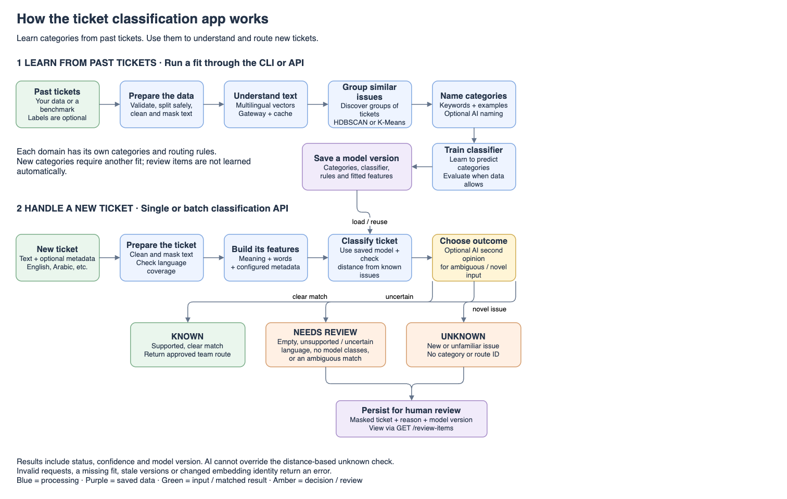
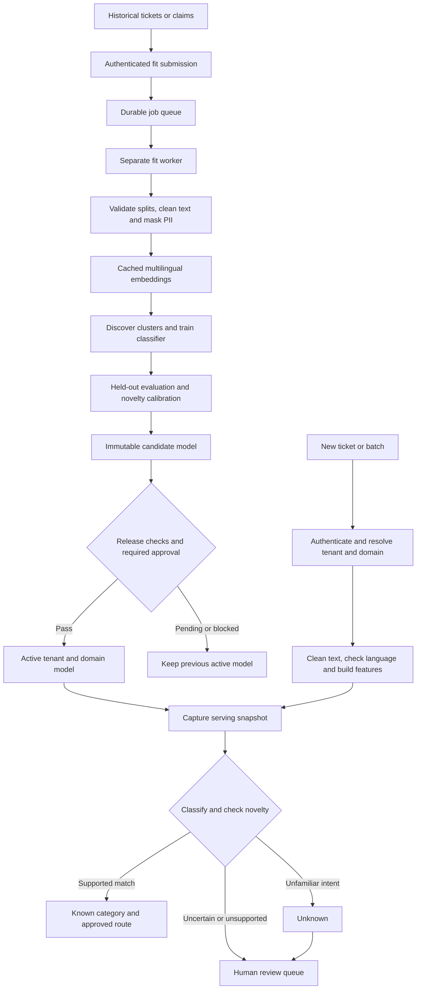

# Ticket and claim classification

Discover categories in historical tickets and classify new text against the resulting taxonomy. The pipeline cleans and masks text, builds multilingual embeddings, discovers clusters with a dataset-dependent category count, and trains a classifier. Domain profiles configure input fields, supported languages, metadata and routing queues for customer service, technical incidents, claims or other industries.

## Guides

- [User guide](docs/user-guide.md): authenticate, fit data, approve a taxonomy, classify tickets and review uncertain results.
- [Production guide](docs/production-runtime.md): deploy the API and worker, configure secrets, monitor health, back up data and roll back models.
- [Domain profile examples](configs/profiles.example.yaml): map customer service, technical incident and claim fields to the pipeline.
- [Editable diagrams](docs/diagrams/README.md): application overview in PNG, SVG and draw.io formats.

## Application flow



The upper flow learns categories from historical tickets. The lower flow classifies new tickets against an active taxonomy. Saving a candidate does not activate it: release checks and any required approval come first.



Training runs independently from HTTP serving. Each prediction captures one model version; a refit or blocked candidate leaves the previous model available. Model files, cache entries, jobs and review records are scoped to tenants, with domain-specific taxonomies and routing rules. A later discovery run is needed to learn new categories.

## How clustering works

The default strategy is **HDBSCAN**, a density-based algorithm that finds groups of similar embeddings and can leave isolated or weakly supported items as noise. The number of clusters is discovered from the data; you do not need to supply K.

1. **Prepare text and evaluation groups.** Map the domain's input columns, normalize text, remove configured boilerplate and mask sensitive values. Keep duplicates, translations and conversation groups within one evaluation partition. Clustering learns from the training partition.
2. **Embed meaning.** Obtain vectors from the configured multilingual gateway deployment. Deduplicate and cache compatible text chunks, combine long-document chunks, and normalize vectors. Languages share categories only when the embedding model aligns them in a common space.
3. **Reduce dimensions.** PCA is the default reduction before discovery. UMAP is optional, and reduction can be disabled. The fitted transform is saved and reused for later predictions.
4. **Select a density model.** Try dataset-derived cluster-size and neighborhood settings. Compare original-space cosine silhouette, accepted coverage, minimum support and stability under resampling. Candidate, sample and work budgets control discovery cost; diagnostics report when sampling or a budget boundary affects the result.
5. **Describe the taxonomy.** Preserve noise assignments, extract class-based TF-IDF keywords and representative tickets, and optionally ask an LLM for names and localized labels. Routing choices must belong to the domain's approved route map. Stable IDs and birth/split/merge diagnostics help review changes between compatible versions.
6. **Learn assignment and rejection.** Train the configured classifiers against supported discovered categories using embeddings, lexical features and optional metadata. Select a classifier on held-out validation data and calibrate the novelty distance threshold on eligible known validation examples. Evaluation reports agreement with clusters separately from labeled business accuracy.

For serving, the saved classifier assigns existing categories and original-space cosine distance to class centroids identifies unfamiliar inputs. This assignment method is a frozen approximation; HDBSCAN is not rerun for each ticket. Unsupported or uncertain language and ambiguous matches go to review. Optional LLM reranking can assist ambiguous assignments while the geometric novelty gate continues to reject unknown inputs.

The `aligned_kmeans` alternative searches a dataset-size/support-derived range of K values, compares separation and stability across seeds, and refines candidates within its budget. The legacy `density` strategy uses DBSCAN. Configure these choices under `clustering` in [pipeline_config.yaml](configs/pipeline_config.yaml). Neither strategy guarantees that discovered groups exactly reproduce a business label taxonomy; review category usefulness and held-out routing quality before activation.

## Installation

Python 3.11 or later and [uv](https://docs.astral.sh/uv/) are required for a native installation:

```sh
uv sync --all-groups --frozen
```

For container deployments, follow the [production setup](docs/production-runtime.md). It runs separate API and fit-worker processes with persistent storage and mounted secrets.

## Configure your domain

Start with [pipeline_config.yaml](configs/pipeline_config.yaml), or adapt [profiles.example.yaml](configs/profiles.example.yaml). Set the input text and identifier columns, supported languages and approved routing queues. The configured embedding deployment must align all supported languages in one vector space. Set `EMBEDDING_REVISION` to an immutable deployment revision and refit whenever that deployment changes.

Example records for the claims profile:

```json
{"claim_id":"c1","narrative":"My payment failed and I need a refund","conversation_id":"thread-1","language":"en","amount":100,"product":"card"}
{"claim_id":"c2","narrative":"حصلت مشكلة في دفع الفلوس ومحتاج استرجع المبلغ","conversation_id":"thread-2","language":"ar","amount":100,"product":"card"}
```

These records illustrate the schema. Training and release evaluation require a representative dataset. Labels are optional; conversation IDs should group translations and paraphrases so they remain in the same evaluation partition.

## Fit and classify

For a native batch fit with your configured environment:

```sh
uv run --frozen ticket-clf --input claims.jsonl \
  --config configs/profiles.example.yaml --domain-id customer_claim \
  --no-llm-naming --report-path data/reports/claims.md
```

Fitting calls the configured embedding gateway even when naming is disabled. HDBSCAN discovers category count directly; the K-Means strategy selects K from feasible candidates within a work budget. Fitting saves a candidate version. Quality checks and any required taxonomy approval must pass before that version becomes active.

The API provides fit submission, job status and cancellation, single and batch classification, taxonomy inspection and a review queue. See the [user guide](docs/user-guide.md) for authentication, request examples, language behavior and release approval.

After a model is approved and active, classify a new ticket:

```sh
curl --fail-with-body http://127.0.0.1:8000/api/v1/classify \
  -H "Authorization: Bearer $TICKET_API_TOKEN" \
  -H 'Content-Type: application/json' \
  --data '{"ticket_id":"live-001","text":"My payment failed and I need help","domain_id":"generic"}'
```

See the [fit and approval walkthrough](docs/user-guide.md#submit-historical-data) for the first model, and the [full benchmark instructions](docs/user-guide.md#run-a-full-benchmark) for dataset-wide evaluation with independent out-of-scope probes.

Predictions have one of three statuses:

| Status | Meaning |
| --- | --- |
| `known` | A supported match with an approved routing queue. |
| `unknown` | An unfamiliar intent without an assigned category or route. |
| `needs_review` | Empty text, unsupported or uncertain language, insufficient class evidence, or an ambiguous match. |

Category IDs remain independent of display language. New categories require another fit; review items are not incorporated automatically. The app returns routing information; delivery to another ticketing system belongs to your integration.

## Operations

Read the [production guide](docs/production-runtime.md) for deployment, secrets, readiness, monitoring, backup and rollback. The bundled storage supports multiple processes on a single POSIX host. Multiple hosts require shared transactional storage and an object-store-backed registry.

Automated tests use synthetic embeddings to verify application behavior. Evaluate real routing accuracy, dialects, minority languages and unknown-intent handling on representative held-out data before activating a production model.
