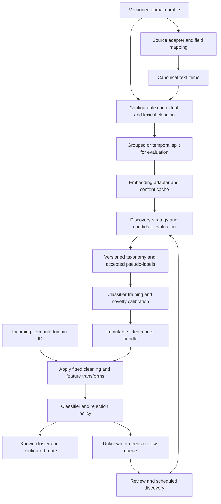

# Ticket and claim discovery: public repository comparison and design review

> **Implementation follow-up:** The review findings below describe revision `69b07c2` before the implementation changes. The current [README](README.md) and [architecture document](PLAN.md) describe the implemented domain/language profiles, HDBSCAN and adaptive K-Means, corrected discovery/novelty contracts, generic fitting, versioned artifacts, lineage and review queue. Real deployed-model multilingual and full multi-domain benchmark results remain separate validation work; the offline tests do not establish those accuracy claims.

Research date: **13 November 2026**. Local revision reviewed: `69b07c257a3fe3891c9858da53279828e537ed92`.

## Recommendation

Keep the project's gateway, embedding cache, classifier suite, and layered application structure. Introduce a domain profile and explicit algorithm interfaces, then benchmark a **BERTopic-compatible discovery strategy using existing gateway embeddings, optional UMAP, and HDBSCAN** against an improved adaptive K-Means strategy. Continue training fast classifiers against the discovered taxonomy, with rejection for unknown issues and versioned taxonomy updates.

The current implementation is a useful prototype, but **does not yet meet the requirements for domain plugins, multilingual processing and dataset-driven cluster discovery**. Changing `--domain` changes LLM prompts; it does not configure ingestion, cleaning, language processing, metadata, or routing. K is selected from an operator-specified interval, and the latest saved benchmark reaches its upper bound.

This is a source review and architecture recommendation, not a performance comparison from running the external projects. The reported local benchmark is historical evidence; no new paid embedding or LLM benchmark was run for this review.

## Search scope and verified repositories

GitHub repository search included `ticket clustering stars:>100`, `ticket classification stars:>100`, `complaint clustering stars:>100`, `claims clustering stars:>100`, named topic-modeling projects, and broader README searches such as `"ticket" "clustering" in:readme stars:>100 language:Python` and `"complaints" "NMF" in:readme stars:>100`.

Star counts below came from the GitHub repository API during this review. They are snapshots, not quality or accuracy measures. Selection includes directly relevant applications and reusable discovery frameworks; these are identified separately. The search did not establish a single qualifying, ready-made application covering every requested stage across customer service, technical tickets, and claims.

| Repository | Verified stars | Type and relevant capabilities | Limitation / applicability |
|---|---:|---|---|
| [MaartenGr/BERTopic](https://github.com/MaartenGr/BERTopic) | 7,955 | General framework: interchangeable embeddings, reduction, clustering, tokenization, topic weighting, and representation; new-document assignment | Best architectural reference. Ticket ingestion, sensitive-data cleaning, business routing, and classifier lifecycle remain application responsibilities. |
| [ddangelov/Top2Vec](https://github.com/ddangelov/Top2Vec) | 3,115 | General framework: discovers topic count using embedding geometry, UMAP and HDBSCAN; topic vectors in original embedding space | Useful independent discovery baseline. Joint word/document representation and contextual model restrictions make it less directly compatible with the current cloud embedding contract. |
| [jxnl/kura](https://github.com/jxnl/kura) | 541 | Conversation analytics: summaries, semantic clustering, hierarchy, disk cache and checkpoints | Useful for long support conversations. README describes batch analysis and MiniBatch K-Means; do not infer automatic K or a production ticket classifier from the name of its visualization reducer. |
| [airweave-ai/error-monitoring-agent](https://github.com/airweave-ai/error-monitoring-agent) | 386 | Incident application: exact source-location grouping, pattern grouping, optional LLM grouping and cluster summaries | Archived. Learn the staged cost-control approach; it is incident-specific and does not implement the complete embedding → discovered-label classifier workflow. |
| [thuiar/TEXTOIR](https://github.com/thuiar/TEXTOIR) | 252 | Research framework: open-intent discovery and detection, extensible methods, banking/CLINC/StackOverflow benchmarks | Best reference for known/unknown evaluation. Methods have different supervision assumptions; not every method is an unlabeled, automatic-K pipeline. |
| [karolzak/support-tickets-classification](https://github.com/karolzak/support-tickets-classification) | 169 | Helpdesk application: email preprocessing, TF-IDF, SVM/Naive Bayes, rare-class filtering and multiple target fields | Supervised classification of existing labels, not unsupervised taxonomy discovery. Legacy code and an anonymized dataset are not a reusable typed-PII masking pipeline. |
| [thuiar/DeepAligned-Clustering](https://github.com/thuiar/DeepAligned-Clustering) | 130 | Research implementation: BERT representation learning, iterative pseudo-labels, centroid alignment and an upper-bound cluster-count estimator | Reference for ideas rather than a drop-in implementation. The local fixed-embedding K-Means heuristic is not the full DeepAligned algorithm. |

Maintenance context: BERTopic's API metadata reported a last push of 2026-11-05 and TEXTOIR 2026-05-18. Top2Vec reported 2024-11-14, Kura 2025-09-10, karolzak 2022-06-21, and DeepAligned 2022-07-01. Airweave reported 2026-01-29 and `archived=true`. A push timestamp alone does not establish maintenance quality. These values can be rechecked through each repository's `https://api.github.com/repos/{owner}/{repo}` endpoint.

Two financial-complaint examples already cited by `PLAN.md` **fail the requested threshold**: [sukhijapiyush/NLP-Case-Study---Automatic-Ticket-Classification](https://github.com/sukhijapiyush/NLP-Case-Study---Automatic-Ticket-Classification) had **12 stars** and [RakshithaBS/Automatic-Ticket-Classification](https://github.com/RakshithaBS/Automatic-Ticket-Classification) had **0**. They should not be presented as qualifying references. Search results for `claims` also include unrelated database systems and general resource lists; these were excluded.

## What the source code supports

### Discovery and dynamic K

[BERTopic's modular pipeline](https://github.com/MaartenGr/BERTopic#modularity) is the closest match to the desired separation of responsibilities. Its default discovery stages combine semantic vectors, reduction, density clustering and topic representation. Existing gateway vectors can be supplied as [precomputed embeddings](https://maartengr.github.io/BERTopic/getting_started/embeddings/embeddings.html#custom-embeddings), avoiding a second embedding provider or duplicate embedding work. [Its clustering documentation](https://maartengr.github.io/BERTopic/getting_started/clustering/clustering.html) also describes alternate clusterers.

[Classic Top2Vec](https://github.com/ddangelov/Top2Vec#classic-top2vec) provides an independent example of finding dense document groups and deriving topic vectors in the original space. Its contextual variant supports multiple topic segments within a document, but the README limits that variant to specified token embedding models. Treat it as an optional research baseline rather than assuming arbitrary cloud vectors can replace its whole representation stack.

[DeepAligned's implementation](https://github.com/thuiar/DeepAligned-Clustering/blob/main/DeepAligned.py) estimates K by fitting an upper-bound K-Means model and discarding undersized groups. It also learns BERT representations through repeated clustering and pseudo-label training. The local code borrows the cluster-size and alignment ideas but adds its own silhouette sweep, a half-density threshold and a distance penalty. Documentation should call this **DeepAligned-inspired adaptive K-Means**, not imply algorithm equivalence.

### Cleaning, normalization, and cost control

[karolzak's preprocessing](https://github.com/karolzak/support-tickets-classification/blob/master/0_preprocess_data.py) contains email/header/footer regex rules. Its [training script](https://github.com/karolzak/support-tickets-classification/blob/master/2_train_and_eval_model.py) provides sparse lexical classifiers and rare-class exclusion. These support the cleaning and class-support lessons; they do not establish the earlier plan's attribution of typed placeholders or automatic rare-cluster merging.

[Airweave's clusterer](https://github.com/airweave-ai/error-monitoring-agent/blob/main/backend/pipeline/clustering.py) groups by module/function/line, then error patterns, then optional LLM semantics. It is not evidence for a general cloud embedding funnel or a universal 60–90% cost reduction. Copy the staged processing principle and measure savings on each dataset.

[Kura's example](https://github.com/jxnl/kura#quick-start) adds cached summaries and checkpoints before batch conversation clustering. This suggests an optional long-thread representation plugin. Evaluate whether summaries preserve multiple issues, negation, product identifiers and error codes before using them as the only embedding input.

### New-item classification and unknown intents

[TEXTOIR](https://github.com/thuiar/TEXTOIR) distinguishes discovery of new intents from detection of an unknown intent. This distinction should remain explicit in the application. Density clustering discovers a taxonomy offline; online classification assigns to a frozen taxonomy or abstains. For the external `hdbscan` package, [approximate prediction](https://hdbscan.readthedocs.io/en/latest/prediction_tutorial.html) assigns new vectors against a fixed fitted structure and does not discover new clusters. Accumulated unknown items require a later discovery run.

## Current implementation versus the requirement

Paths and line numbers refer to the reviewed local revision.

| Concern | Current evidence | Assessment / required change |
|---|---|---|
| Separation of concerns | Controllers, application service, entities, repositories, gateway and algorithm modules | Keep this foundation. The service still constructs concrete engines and owns ingestion through evaluation; add strategy injection and separate reusable fitting from benchmarks. |
| Domain selection | `config/settings.py:75` and `controllers/cli.py:19`; domain text is injected into naming/reranking prompts | Partial. Add versioned profiles for source mapping, language, cleaning, metadata, chunking, routing and novelty policy. |
| Generic ingestion | `repositories/dataset_repo.py:18` and `:61`: fixed benchmark catalog and format-specific field renames | A benchmark loader rather than a general connector. Add a canonical record adapter for arbitrary tables/files and a generic fit entry point. |
| Runtime configuration | `config/settings.py:136` defines `load_pipeline_yaml()`; no source call sites consume it | YAML settings currently do not control execution. Validate and apply configuration once, with explicit precedence and failure on unsupported choices. |
| Cleaning | `domain/cleaning/handlers.py:307`: one fixed chain | Useful composable handlers, but no domain-configured selection. Blanket HTML regex can remove angle-bracket content; masking rules cover limited formats. Add policy-specific tests and preserve useful technical tokens. |
| Lexical normalization | `handlers.py:223` restricts tokens to `[a-z]`; `:274` applies handcrafted English suffix rules | Does not provide language-neutral lexical features. Add Unicode-aware tokenization and optional language plugins; preserve negation and domain terms where they distinguish issues. Contextual text is less aggressively normalized and should remain so. |
| Semantic normalization | `domain/clustering/engine.py:50`: L2 normalization, PCA, then L2 normalization | Actual reducer is PCA, not UMAP. Keep PCA as a baseline and make reduction selectable and frozen after fitting. |
| Embeddings | `services/pipeline_service.py:228` and cache repository | Exact-text deduplication, batching and model/base/dimension cache identity are implemented. Keep them; validate vector count/dimensions/finiteness and pin the complete fitted embedding identity. |
| Template funnel | `pipeline_service.py:424`: counts unique templates after embedding | Template counts are diagnostics. They currently do not reduce embedding calls or implement pattern-based semantic grouping. |
| Clustering strategy | `pipeline_service.py:413` always instantiates `aligned_kmeans` | Not pluggable through the normal service. Engine's `density` branch is DBSCAN with fixed `eps=0.35`, not HDBSCAN. YAML's `hdbscan_density` and `nmf_topic` are unsupported advertised options. |
| K estimation | `domain/clustering/engine.py:61`; CLI defaults 5–12, service defaults 5–14, YAML says 4–20 | Adaptive within fixed bounds, not broad dataset-driven discovery. Boundary detection exists, but no automatic expansion or candidate stability evaluation follows it. |
| Training assignments | `domain/base_stage.py:37`, `clustering/engine.py:250` and `:266` | Stored recovered/noise labels are replaced by nearest-centroid predictions in `fit_transform()`. Fix before using discovery labels to train a classifier. |
| Cluster descriptions | `clustering/engine.py:285` | Clusters are concatenated and passed to ordinary `TfidfVectorizer`. This is an approximation, not BERTopic's class-based weighting. Examples are closest to a mean vector, not pairwise-distance medoids. Use precise names or implement the stated algorithms. |
| Classification | `domain/classification/engine.py:61` | Correct overall pattern: classifiers learn discovered cluster IDs, with confidence/support filtering. However, the support filter relaxes its minimum when fewer than two classes survive. Add explicit one-class/no-class handling. |
| Novelty | `classification/engine.py:85` and `:160` | Quantile learned from in-sample training distances; inference multiplies the threshold by 1.15. Calibrate on held-out data in one consistent feature space and report coverage versus error. |
| Metadata | `pipeline_service.py:379` constructs `MetadataFeaturePipeline()` with no configured columns | Encoder supports column types, but service effectively uses text length, word count and empty-text indicator. Wire profile schemas and enforce identical columns/order at inference. |
| Persistence and isolation | `pipeline_service.py:95`, `controllers/api.py:49` | One mutable model bundle per data directory. No domain/taxonomy version in requests. Separate artifacts and routing by domain and immutable model version. |
| Cluster identity | `clustering/engine.py:120`; a new engine is created in each benchmark run | Alignment exists for repeated fits on the same engine with equal shapes. Normal retraining loses previous centroids; changing K resets to identity mapping. Add cluster births, retirement, splits and merges. |
| Evaluation | `pipeline_service.py:490` onward and `BENCHMARK_REPORT.md` | Cluster agreement and train-mapped ground-truth metrics are both present, which is useful. Model selection optimizes cluster agreement; this alone cannot validate semantic/business correctness. |

The base stage enforces fit-before-transform, but cannot establish that the caller supplied only training data. The service does fit its learned transforms on training partitions. Exact/near duplicates and conversations also need group-aware splitting; the embedding cache does not prevent split contamination.

## Correctness findings verified locally

The existing suite passed: **8 tests**, using `.venv/bin/python -m pytest tests -q`. Additional read-only probes reproduced gaps the suite does not cover:

1. **Training noise is lost.** With `np.random.default_rng(42).normal(size=(100, 32))` and `ClusteringEngine(k_min=2, k_max=4, n_components=10)`, stored training labels contained **27 noise points**. Returned `fit_transform()` labels contained **0**; all 27 differed. Return fitted discovery assignments and their appropriate strengths explicitly, keeping inductive prediction separate.
2. **Projection depends on inference batch size.** After that fit, `engine.transform(X[:1])` failed with a matrix multiplication dimension mismatch, **10 versus 32**. `_project_embeddings()` recalculates `n_comp` from the new batch size and skips the fitted PCA for a single item. Always apply the fitted projection policy. Live classification currently uses its separate raw-embedding classifier path, so this probe specifically demonstrates a cluster-transform contract failure.
3. **Very small datasets fail.** Fresh default engines fitted on 1, 2 or 3 rows each raised `n_samples ... should be >= n_clusters=4`. Define explicit empty, insufficient-data, one-cluster and all-noise outcomes rather than forcing multiple clusters.

Two additional source-level issues need priority:

- **The OOS recall calculation differs from the serving gate.** `pipeline_service.py:607` computes probe distances to projected-space clustering centroids, but compares them to a threshold fitted in original embedding space. It also omits serving's `* 1.15` adjustment. The saved **1.0 recall on six probes** is not validated end-to-end novelty performance. The fixed probes can themselves be legitimate tickets in another domain, such as office-equipment support.
- **A novel result can retain a known cluster ID/title.** `pipeline_service.py:853` sets `novel` without clearing the original `pred_cid`; the result can combine a known category with the emerging-issues queue. Define an explicit unknown status and nullable/sentinel category consistently. Store the rejected item for later review/discovery rather than only returning a flag.

The saved banking benchmark contains **397 rows, 8 ground-truth categories and K=12 at the upper boundary**. It reports logistic regression ground-truth macro-F1 **0.8753** and cluster-agreement macro-F1 **0.9624**. Those measure different things. Neither establishes performance on full Banking77, technical tickets, claims, or an unrestricted dynamic-K run. The boundary result warrants expansion and stability checks; it does not prove the true K is above 12. Ground-truth category count is an evaluation reference, not an input to K selection.

## Proposed domain-agnostic architecture

The engine should operate on canonical text items. A domain plugin supplies interpretation and policy; it should not require an alternative copy of the pipeline. Separate domain datasets/taxonomies by default. A shared taxonomy across multiple domains should be an explicit deployment choice.

Minimal contracts to add:

- **DomainProfile:** profile ID/version, input field mappings, languages, enabled cleaning rules, sensitive-data patterns, preserved tokens, chunk policy, metadata schema, approved routes, and review thresholds. Provide `generic`, `customer_service`, `technical_incident` and `customer_claim` profiles as examples.
- **DatasetAdapter:** map CSV/JSON/dataframes or external systems into item ID, text, metadata, optional label, conversation/group ID and timestamp. Labels are optional and belong to evaluation or explicitly supervised modes.
- **EmbeddingProvider:** batch embedding and a resolved model identity including actual model/deployment revision, dimensions and preprocessing/task configuration. Extend the current gateway rather than replace it. Pin the identity in artifacts; a mutable gateway alias or provider name alone is insufficient.
- **DiscoveryStrategy:** fit only on the discovery training set; return assignments including noise, confidence/strength semantics, discovered K, representatives and diagnostics. Keep prediction against the frozen model a separate capability.
- **ClassifierStrategy / NoveltyPolicy:** learn accepted pseudo-labels, calibrate rejection, and return `known`, `unknown` or `needs_review`. Do not treat cosine similarity, density membership strength and calibrated class probability as interchangeable.
- **TaxonomyRegistry:** immutable domain/model/taxonomy versions, embedding identity, preprocessing fingerprint, reducer, discovery model, classifier and thresholds. Maintain lineage across different cluster counts. Bind routing to approved profile routes; a generated cluster name is not authorization to invent a production queue.

The profile should distinguish business-sensitive values from semantic signals. For technical incidents preserve tokens such as `HTTP 403`, `HTTP 404`, exception classes, paths and versions where useful. For claims normalize redactions and sensitive identifiers while preserving dispute type and relevant money/date semantics according to policy. For customer service preserve product/SKU and issue wording. Use Unicode-aware defaults; require a language plugin only where specialized normalization is beneficial.

For long claims or email threads, optionally embed chunks and aggregate or retain segment assignments. An item can contain multiple issues; preserve that possibility in the contract even if the initial router chooses one primary queue. Empty narratives should be flagged and handled through review/metadata policy rather than allowed to create a spurious semantic category.

## Multilingual processing: required behavior

**Language support is a core pipeline requirement, independently configurable from industry or domain.** One domain can contain several languages, and a ticket can mix languages and scripts. Initial validation should include English, Arabic (including Egyptian Arabic), and mixed Arabic/English tickets, with additional languages declared and evaluated through configuration. These are acceptance targets, not claims of current implementation support.

The default design should discover **shared semantic clusters across supported languages**: an Arabic complaint and an English complaint about the same underlying issue should be eligible for the same category. Language-specific taxonomies remain an explicit profile option where operational routing requires them. Different wording or language alone should not create a new issue category or increase K.

| Stage | Required design |
|---|---|
| Input and language metadata | Preserve original text. Accept an optional language hint and detect language/script with confidence; support multiple languages per item or segment and an `undetermined` result for short/ambiguous text. Keep source hint and detected result separate. |
| Cleaning | Use Unicode-aware parsing, whitespace and normalization policies. Preserve original script, meaning-bearing characters, technical identifiers and negation. Keep any Arabic character/diacritic normalization configurable; avoid global character folding or transliteration that merges distinct terms. |
| Language plugins | Separate language rules from domain rules. Provide configurable tokenizers/segmenters, stopwords, optional morphology, localized email boilerplate and sensitive-data patterns. A missing specialized tokenizer must not silently erase non-Latin text or force English suffix rules onto it. |
| Embedding | Require a validated multilingual embedding model that places the supported languages in one aligned space. Embed contextual text directly by default. Never combine independently generated language-specific vector spaces merely because their dimensions match. Persist the resolved model revision and preprocessing/task policy. |
| Translation | Make translation an optional strategy for evaluated gaps in language coverage. Retain source text, translated text, source/target language and translation model/version; include the representation policy in cache/artifact identities. Compare meaning preservation and cost before making translation mandatory. |
| Clustering and dynamic K | Evaluate mixed-language training data in the shared embedding space. Check whether categories separate by issue or by language using bilingual matched examples and per-language coverage/stability. Preserve genuinely language-specific issues; do not impose identical assignments on unrelated tickets. |
| Keywords and descriptions | Produce language-aware lexical representations and keywords by language. Keep cluster IDs independent of display language; allow localized names/descriptions and representative items from multiple languages. Shared embedding features should support prediction even when language-specific lexical vocabulary is sparse. |
| Classification and novelty | Reuse the same fitted multilingual representation online. Report confidence/rejection by language; calibrate language-specific thresholds only with sufficient held-out evidence, otherwise use the documented fallback. Unsupported/undetermined language is a language-coverage status, distinct from an unseen business intent. |
| Routing and API | Keep operational category/queue IDs stable across translated display labels. Include input language(s), detection confidence, domain ID, taxonomy version and language-coverage status in prediction metadata. A requested response language controls presentation, not the semantic category. |

Extend `DomainProfile` with a composable `LanguagePolicy`: supported languages, detection strategy, mixed-language handling, normalization/tokenization plugins, multilingual representation identity, optional translation fallback, taxonomy language mode and display-language policy. Persist the resolved policy in the fitted bundle so training, reload and inference apply the same rules. Version any changed representation policy and refit the affected models.

The current `[a-z]` lexical extractor, English stopword list, English suffix rules and ASCII-only template signatures are concrete gaps. The contextual embedding path preserves more of the source text, but that alone does not establish end-to-end multilingual correctness. Generic language models or provider switching also do not establish equivalent quality across languages.

Acceptance evidence must include:

- Arabic, English and mixed-language narratives retain meaningful contextual text and usable lexical features where configured; include non-Latin scripts, Unicode variants and localized PII examples.
- Human-reviewed Arabic/English pairs expressing the same issue can receive the same semantic category, while closely related but distinct issues remain distinguishable. Include dialect, negation and technical-token examples.
- A minority language retains acceptable cluster coverage and routing quality in an imbalanced multilingual dataset. Report per-language and overall metrics, cross-language pair agreement, unknown-intent errors and language-coverage failures separately.
- K selection records language composition and checks for unintended language-only fragmentation. Hold translations, paraphrases and conversation variants in the same evaluation group to avoid leakage.
- Single-item, batch and reloaded inference apply identical language policy; supported language changes affect presentation consistently without changing immutable category IDs solely due to the display language.

## Dynamic K: recommended selection policy

**Dynamic K means deriving useful grouping granularity from the actual dataset and representation.** It does not mean recovering a unique objective number of business categories. Embedding model, language mix, sample size, density and desired routing granularity all affect the result. HDBSCAN removes an explicit K input, but still requires density/support choices; its [parameter guidance](https://hdbscan.readthedocs.io/en/latest/parameter_selection.html) explains the impact of `min_cluster_size` and `min_samples`.

1. Audit nonempty unique training items, repeated-template frequency, embedding dimensions and finite values. Preserve occurrence counts. Deduplication for API cost and duplicate weighting for discovery are separate choices; evaluate density effects before collapsing repeated events.
2. Compare **L2-normalized embeddings with PCA** and an **optional UMAP projection** fitted on training data. Freeze each fitted reducer for validation/inference. Evaluate embedding-space coherence alongside projected-space structure; a better projection silhouette alone does not establish better categories.
3. For the default candidate family, fit **HDBSCAN** across a bounded, dataset-size-aware set of support and density parameters. Use cosine geometry for input-neighbor construction and a compatible metric for the reduced representation. Keep K as the number of accepted non-noise groups, with noise coverage reported separately. If using `hdbscan.approximate_predict`, choose the external package and persist its prediction data; do not assume every HDBSCAN implementation exposes that API.
4. Retain **adaptive K-Means** as a baseline or explicit fallback. Derive feasible bounds from unique usable training rows and minimum support, constrained by a compute budget. Search coarse candidates, refine around promising values, and expand when a boundary winner is still improving. Record budget exhaustion rather than present a capped answer as unconstrained discovery. Ordinary K-Means on normalized inputs is not automatically spherical K-Means.
5. Score candidate quality using **resampling/seed stability, cluster support distribution, coverage/noise fraction, embedding-space separation and representative coherence**. For density candidates include persistence or a density validity measure where available. Compute sampled silhouette on a fixed evaluation sample when needed; the current full pairwise sweep becomes expensive. Do not optimize silhouette over only a tiny easy subset without penalizing the rejected majority.
6. Accept one cluster, no supported clusters or insufficient evidence as valid outcomes. Do not automatically force K-Means when density discovery finds fewer than two clusters. If an approved operational fallback is needed, label it as such in diagnostics.
7. Name and optionally organize accepted clusters into a hierarchy. Train a classifier on supported, high-quality assignments only, calibrate unknown rejection on held-out data, and publish the model/taxonomy bundle together.

Neither ground-truth labels nor a known benchmark class count should determine K in the unsupervised mode. A domain profile can specify minimum operational support and preferred hierarchy depth without fixing K.

## Delivery order and acceptance criteria

| Priority | Work | Evidence required |
|---|---|---|
| 1 | Fix fitted assignment return values, batch-independent projection, tiny/one-class/all-noise handling, OOS gate consistency and unknown response semantics | Fitted labels preserved; one-item and batched predictions agree; no forced multi-cluster result on insufficient data; novelty benchmark calls the same gate used in serving. |
| 2 | Wire typed YAML/domain/language profile configuration, strategy factory and generic fit API; persist resolved profile/embedding identity | Add a new input schema/domain by configuration; preserve supported scripts and mixed-language inputs; unsupported strategy names fail clearly; reload reproduces preprocessing and predictions. |
| 3 | Add HDBSCAN strategy and adaptive K-Means candidate selection with diagnostics | Candidate bounds/parameters, selected K, coverage, stability, budget and boundary status are recorded. Full 77-intent/150-intent data is not silently limited to the old 12/20 cap. |
| 4 | Separate domain artifacts, taxonomy lineage and unknown-item collection | Different domains do not overwrite each other's models; changed K supports new/retired/split/merged IDs; new taxonomy versions retrain their corresponding classifiers. |
| 5 | Run comparable multi-domain and multilingual experiments and tune deployment tradeoffs | Same splits/embeddings for discovery comparisons; per-language quality/coverage and cross-language semantic agreement; distinct reports for classifier agreement, unknown detection, latency and cost. |

Evaluation should include full **Banking77**, **CLINC with held-out/OOS intents**, **technical tickets**, and **CFPB claims**, with provenance and sample counts. Add multilingual, long-text, missing-text, imbalanced, duplicated and multi-issue slices. Use conversation/duplicate groups and temporal splits where available. Discover and tune without test-label feedback; use labels only for external evaluation unless a supervised mode is declared.

Report ARI/NMI where reference labels exist, human-reviewed coherence/routing usefulness, classifier agreement with the frozen taxonomy, train-only taxonomy-to-label mapping for business metrics, and known/unknown precision-recall or AUROC plus false-positive rates at chosen operating points. Keep a direct frozen-cluster/prototype assignment baseline to show what the downstream classifier adds. Measure latency including embedding and optional LLM calls as well as cached classifier-only latency; report actual tokens/cost rather than assumed savings. Retain the current leakage-conscious transform fitting and bootstrap reporting while making duplicate grouping and metric semantics explicit.

## Corrections to carry into the original plan

- Treat UMAP/HDBSCAN, NMF, domain profiles and a template embedding funnel as proposed features until implemented and connected to the service.
- Describe the existing keyword extraction as TF-IDF over aggregated cluster documents. [BERTopic's actual class-based transformer](https://github.com/MaartenGr/BERTopic/blob/master/bertopic/vectorizers/_ctfidf.py) uses a different term-frequency/IDF formulation.
- Describe current examples as centroid-nearest representatives unless true medoids are implemented.
- Remove unverified cross-project accuracy, sub-millisecond end-to-end latency and 60–90% cost-saving generalizations. No like-for-like external performance experiment was performed here.
- Do not claim Hungarian alignment makes cluster IDs permanently deterministic: retraining, embedding-space changes, births, splits and merges require explicit lineage policy.
- Distinguish software framework reuse from application readiness, and supervised label prediction from unsupervised taxonomy discovery.
