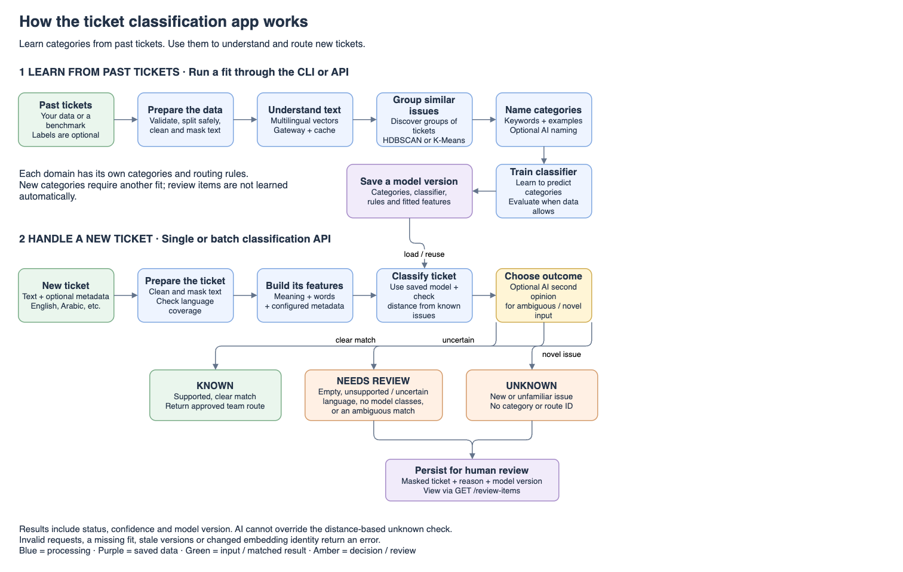

# Application flow

The upper flow learns categories from historical tickets. The lower flow uses an active model to classify new tickets as `known`, `unknown` or `needs_review`. Saved candidate versions become available for inference only after release checks and required approval pass. Review items are not learned automatically.

[Open the editable diagram](open-application-flow.html), [download the draw.io source](application-flow.drawio), or [view the SVG](application-flow.svg). See the [user guide](../user-guide.md) for requests and the [production guide](../production-runtime.md) for the worker and release lifecycle.
